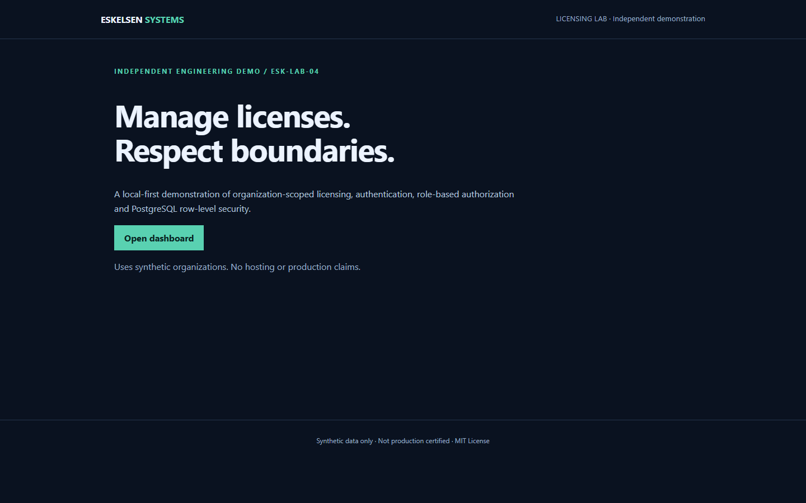
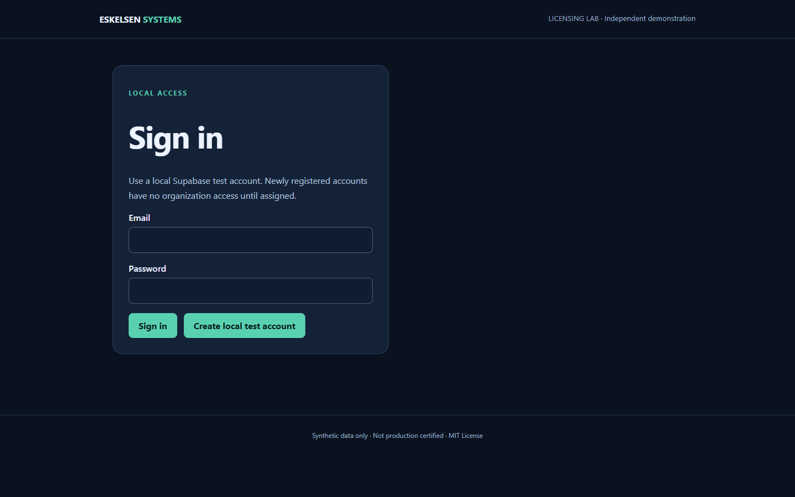

# Eskelsen Licensing Portal | ESK-LAB-04 | v1.0.1

## Application Preview

These screenshots were captured from the running local application using Microsoft Edge and Playwright, with no authenticated session or production data.

### Public landing page



### Local authentication page



The protected dashboard and authenticated cross-tenant workflows are not represented by these screenshots. See [Execution results](docs/RESULTS.md) and [Limitations](docs/LIMITATIONS.md).


**Next.js + TypeScript + Supabase/PostgreSQL | Multi-tenant SaaS engineering demo**

An independent, local-first engineering demonstration by Eskelsen Systems.

This repository illustrates how a business application can organize license records across multiple organizations, restrict access using membership and roles, and validate security-sensitive operations with automated tests.

**Status:** GitHub source release candidate with authenticated-security verification pending. Not a production deployment, independently audited system, or security certification.

## What the demo demonstrates

- Next.js App Router and TypeScript application structure.
- Supabase Auth integration and PostgreSQL data modeling.
- Organization memberships and role-sensitive operations.
- PostgreSQL Row Level Security (RLS) policies.
- License records, document and renewal metadata, and audit activity.
- Constrained CSV import with explicit organization membership checks.
- Unit/static tests, a runnable authenticated integration matrix, browser test sources, and a documented production-build procedure (the last three require independent execution for this revision).

## Verification status (release v1.0.1)

The **v1.0.1** source revision fixes membership visibility, admin/client UI separation, import bounds, calendar-date handling and the Windows preflight port inventory. **17/17 built-in Node.js unit/static tests passed independently on Node.js 22.16.0 on 2026-11-08.**

The prior v1.0.0 release included historical reports of a successful TypeScript/Next.js build, local SQL RLS checks and anonymous browser checks. Those results are **historical** and must not be interpreted as re-executed results for v1.0.1. No local Supabase/Docker runtime or dependency installation was available to rerun the full application here.

A real three-role/two-organization integration test and authenticated Playwright tests are **now included as executable source**, but have **not been executed** against the current v1.0.1 application. Follow [Local synthetic fixtures](docs/LOCAL_TEST_DATA.md), [Test plan](docs/TEST_PLAN.md) and [Current verification](docs/RESULTS.md). The label **"Verified authenticated multi-tenant demo" is withheld** until those checks pass on a disposable local stack.

"GitHub source release candidate" means the archive is curated for publication without included credentials; it does not mean an application-security certification or production deployment.

## Security design

- Application requests use user-scoped Supabase authentication instead of embedding elevated service-role credentials in the application.
- New signups are not automatically assigned to organizations.
- RLS defines tenant and role boundaries at the database layer; the v1.0.1 additive migration restricts membership viewing to the current user.
- The import endpoint validates authenticated organization membership, limits request size before multipart parsing, and accepts only constrained CSV syntax.
- Database constraints are designed to prevent cross-organization references.
- CSV import is intentionally limited rather than accepting ambiguous formats.

These are design and test claims, not a guarantee that all security risks have been eliminated.

## Local development

**Prerequisites:** Compatible Node.js/npm installation, Docker Desktop or another suitable local container runtime, and the Supabase CLI.

Use a disposable, isolated local database. Never run a reset or migration against a production or shared database without a separate authorization and backup procedure.

```powershell
node --version
npm --version
docker version
npm ci
npx supabase start
# Only run db:reset against the disposable local stack, never a shared environment
npx supabase status
Copy-Item .env.example .env.local
```

Set the local Supabase URL and local publishable/anon key in `.env.local` using the values reported by your own local Supabase instance. Do not commit `.env.local` or paste credentials into public issues.

```powershell
npm test
npx tsc --noEmit
npm run build
npm run dev
```

Open the local URL reported by Next.js (normally `http://localhost:3000` unless the port is changed).

To exercise protected pages, use synthetic local accounts and configure test organizations and memberships in the disposable local Supabase instance. For **automated real-JWT checks** and authenticated browser tests, follow [Local test data](docs/LOCAL_TEST_DATA.md) and [Test plan](docs/TEST_PLAN.md). These scripts create and delete synthetic fixtures only on the explicitly allowed loopback local Supabase port 55321.

Browser testing can use Playwright and an installed compatible browser. Do not assume every machine already has a Playwright-managed Chromium download.

## Scope and intentional exclusions

This is a technical demonstration, not a commercial licensing service. It does not include payment processing, tenant self-service provisioning, production monitoring, full renewal automation, or comprehensive security hardening.

The CSV parser accepts a constrained subset of CSV; advanced quoted fields and Excel `.xlsx` imports are not supported.

See [Limitations](docs/LIMITATIONS.md) before adopting any portion for production use.

## Repository layout

| Path | Purpose |
| --- | --- |
| `src/` | Next.js application and server logic |
| `supabase/` | Local Supabase configuration and database migration |
| `tests/` | Unit/static and browser test sources |
| `docs/` | Architecture, limitations, test plan, and results |
| `scripts/` | Optional local inspection and test helpers |
| `.env.example` | Configuration template without real credentials |

Private execution evidence, environment secrets, caches, and local test records are deliberately excluded from the public release.

## License

MIT License. Copyright (c) 2026 Eskelsen Systems.

See [LICENSE](LICENSE). Third-party dependency licenses apply independently.

## Publication checklist

Read [GITHUB_UPLOAD.md](docs/GITHUB_UPLOAD.md) and [Release notes](docs/RELEASE_NOTES_v1.0.1.md) before publishing. Do not upload `.env.local`, service-role keys, local logs or synthetic account passwords. Public screenshots show anonymous pages only.
